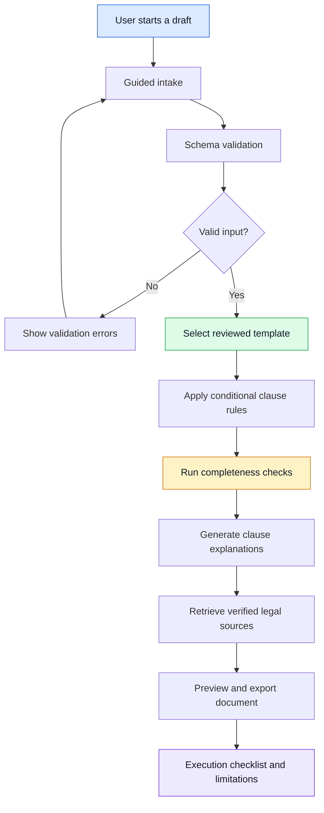
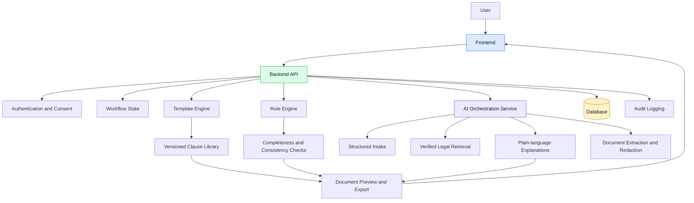

 

# ⚖️ AI Legal Drafting & Review Platform for India

### Smarter contract drafting. Clearer legal language. Safer workflows.

An AI-assisted platform that helps Indian freelancers and small businesses draft freelance service agreements, understand clauses in plain language, and identify missing or potentially risky terms.

  
  
  
  

**Reviewed templates · Deterministic rules · Retrieval-grounded AI**

[Overview](#-overview) · [Features](#-key-features) · [Architecture](#-architecture) · [Roadmap](#-interactive-project-roadmap) · [Security](#-privacy--security)

---

## 📑 Table of Contents

<strong>Explore the documentation</strong>

- [Overview](#-overview)
- [Problem Statement](#-problem-statement)
- [Goals and Non-Goals](#-goals)
- [Key Features](#-key-features)
- [Core Design Principle](#-core-design-principle)
- [Phase 1: Freelance Agreement Workflow](#-phase-1-freelance-agreement-workflow)
- [India-Specific Legal Coverage](#-india-specific-legal-coverage)
- [Architecture](#-architecture)
- [Technology and Component Approach](#-component-approach)
- [Phase 2: Existing Document Review](#-phase-2-existing-document-review)
- [Legal Content and Validation](#-legal-content-and-validation)
- [Evaluation Plan](#-evaluation-plan)
- [Privacy and Security](#-privacy--security)
- [Interactive Project Roadmap](#-interactive-project-roadmap)
- [Team and Module Ownership](#-team-and-module-ownership)
- [Risks and Mitigations](#-risks-and-mitigations)
- [Open Questions](#-open-questions)
- [Success Criteria](#-success-criteria)
- [Limitations](#-transparent-limitations)
- [Contributing](#-contributing)

---

## 🎯 Overview

**AI Legal Drafting and Review Platform for India** is an AI-assisted legal document platform designed for individuals, freelancers, and small businesses.

The platform aims to make basic contract drafting more structured and understandable through guided workflows, reviewed legal templates, deterministic validation, plain-language explanations, and verified legal references.

### Project at a glance

| Attribute | Details |
|---|---|
| Project status | Planning |
| Initial users | Freelancers and small businesses in India |
| Phase 1 document | Freelance service agreement |
| Phase 2 feature | Existing document review |
| Generation approach | Reviewed templates and deterministic rules |
| AI role | Intake assistance, explanations, extraction, retrieval |
| Legal review | Required before release of legal content |

## ❗ Problem Statement

Freelancers and small businesses often work without written contracts or rely on copied templates they may not understand.

This can lead to:

- Unclear project scope and deliverables.
- Delayed or unpaid invoices.
- Ambiguous intellectual property ownership.
- Missing confidentiality or termination terms.
- Unclear dispute-resolution provisions.
- Uncertainty about signing and stamp-duty requirements.

Lawyers remain essential, but professional legal support may be unaffordable for smaller engagements.

This project aims to make basic contract drafting more accessible while clearly communicating the limitations of automated assistance.

## 🎯 Goals

- [ ] Produce complete freelance agreements from guided user input.
- [ ] Explain every included clause in plain language.
- [ ] Detect missing terms using deterministic completeness checks.
- [ ] Maintain consistency between payment, dates, parties, and deliverables.
- [ ] Provide citations only from a curated, verified legal corpus.
- [ ] Protect sensitive user information.
- [ ] Maintain versioned templates and an auditable review process.

### Non-goals

- Replacing lawyers or providing individualized legal representation.
- Guaranteeing enforceability or legal outcomes.
- Allowing unrestricted AI generation of binding contract clauses.
- Supporting multiple document types in the first release.

---

## ✨ Key Features

<strong>Phase 1 — Guided contract drafting</strong>

- Guided intake for parties, scope, deliverables, fees, timelines, and payment terms.
- Conditional inclusion of reviewed contract clauses.
- Input validation and cross-field consistency checks.
- Automated completeness checks.
- Plain-language explanations for each clause.
- Source-backed legal information when verified sources are available.
- Document preview and export.
- Execution checklist and limitations notice.

<strong>Phase 2 — Existing document review</strong>

- PDF and DOCX document uploads.
- Text extraction with OCR fallback.
- Extraction of parties, dates, payment terms, and clause types.
- Detection of missing or unusual terms.
- Comparison with the reviewed clause library.
- Risk explanations and prompt-injection defenses.

<strong>Security and transparency</strong>

- Explicit consent and data minimization.
- PII redaction before third-party LLM calls.
- Encryption in transit and at rest.
- Access controls and audit logging.
- User-initiated deletion and retention limits.
- Clear handling of unsupported legal questions.

---

## 🧠 Core Design Principle

The platform follows a **deterministic legal logic with constrained AI** approach.

> The AI assists with understanding and information extraction. Reviewed templates and deterministic rules control the contract-generation process.

| Task | Responsible component |
|---|---|
| Selecting a template | Rule-based logic |
| Including or excluding clauses | Versioned conditional rules |
| Validating dates and amounts | Deterministic validation |
| Checking document completeness | Deterministic rule engine |
| Guiding the user through intake | LLM with structured output |
| Explaining clauses | LLM grounded in reviewed content |
| Answering legal questions | Retrieval over verified sources |
| Extracting uploaded document content | LLM with schema validation |
| Exporting the agreement | Document-generation service |

The model must not invent binding clause text. Clause wording must come from reviewed templates.

---

## 🔄 Phase 1: Freelance Agreement Workflow

The initial release focuses on one document type and a complete end-to-end workflow.

### How it works

### Workflow stages

<strong>1. Guided intake</strong>

Collect structured information about:

- Client and freelancer identities.
- Services, project scope, and deliverables.
- Fees, milestones, and payment schedules.
- Deadlines and acceptance criteria.
- Intellectual property ownership or licensing.
- Confidentiality obligations.
- Termination conditions.
- Governing law, jurisdiction, and dispute resolution.

<strong>2. Validation</strong>

Validate user input against a defined schema.

Examples:

- Required fields are present.
- Dates are valid and logically consistent.
- Payment milestones reconcile with the agreed fee.
- Parties and responsibilities are clearly identified.
- Conditional fields are present when required.

<strong>3. Template-based generation</strong>

Assemble the agreement from lawyer-reviewed templates and clause records.

Each clause is selected through explicit rules. The system must not silently substitute unreviewed AI-generated legal language.

<strong>4. Completeness and risk checks</strong>

Check for missing required or recommended terms, inconsistent information, and configured risk indicators.

The system reports findings with explanations rather than guaranteeing that the contract is legally sufficient.

<strong>5. Explanations and legal references</strong>

Explain each selected clause in plain language using its reviewed text and relevant verified sources.

If a legal claim cannot be verified, the platform must disclose the uncertainty rather than fabricate a citation.

<strong>6. Export and execution checklist</strong>

Provide a document preview and export, together with an appropriate limitations notice.

The execution checklist should address relevant signing methods, stamp-duty considerations, and other requirements that have been verified for the applicable circumstances.

---

## 🇮🇳 India-Specific Legal Coverage

The platform plans to cover the following areas. Every legal rule and user-facing explanation requires verification by a qualified legal reviewer before release.

<strong>Stamp duty and execution requirements</strong>

- State-wise variation in stamp duty.
- Relevant e-stamping procedures.
- Execution method and applicable requirements.
- Verification of current state-specific rules.

<strong>Intellectual property</strong>

- Copyright assignment and licensing.
- Ownership of deliverables and pre-existing materials.
- Scope of rights granted.
- Assignment-related requirements under applicable copyright law.

<strong>Tax considerations</strong>

- GST considerations for service providers.
- TDS-related considerations.
- Clear distinction between general information and tax advice.

<strong>Dispute resolution</strong>

- Governing law.
- Jurisdiction.
- Arbitration clauses where appropriate.
- Consistency between dispute-resolution provisions.

<strong>Electronic signatures</strong>

- Relevant considerations under the Information Technology Act, 2000.
- Applicable signing methods and exclusions.
- Verification of legal requirements before making claims about validity.

**Legal content policy:** Public legal materials may support research, but only reviewed and verified materials enter the production retrieval corpus.

---

## 🏗️ Architecture

### Architecture components

| Component | Responsibilities |
|---|---|
| Frontend | Guided forms, preview, explanations, limitations notices |
| Backend API | Authentication, workflow orchestration, APIs |
| Template engine | Clause selection and document assembly |
| Rule engine | Validation, completeness, and consistency |
| Database | Users, drafts, templates, clauses, consent, audit events |
| AI service | Structured intake, explanations, retrieval, extraction |
| Document service | Parsing, redaction, preview, export |
| Infrastructure | CI/CD, monitoring, encryption, environment separation |

All modules should communicate through documented API contracts using OpenAPI. Contracts should be reviewed before implementation.

---

## 🧩 Component Approach

| Component | Implementation approach |
|---|---|
| Template selection | Versioned deterministic rules |
| Clause inclusion | Conditional logic |
| Completeness checks | Deterministic validation |
| Guided intake | LLM with structured output |
| Clause explanations | Grounded LLM responses |
| Document extraction | LLM with JSON Schema validation |
| Legal citations | Retrieval over verified sources |
| Unsupported questions | Explicit refusal or uncertainty |
| Audit trail | Structured audit events |
| API communication | OpenAPI contracts |

The final technology choices, model provider, and deployment architecture remain subject to project requirements and security review.

---

## 📄 Phase 2: Existing Document Review

Phase 2 will be implemented only after the Phase 1 drafting workflow has been completed and evaluated.

### Planned capabilities

- [ ] Upload PDF and DOCX files.
- [ ] Extract text and use OCR when necessary.
- [ ] Extract parties, dates, payment terms, and clause categories.
- [ ] Validate extracted information against schemas.
- [ ] Compare document content against the reviewed clause library.
- [ ] Identify missing, unusual, or potentially risky terms.
- [ ] Explain findings in plain language.
- [ ] Defend against prompt injection in uploaded content.
- [ ] Apply redaction and access controls to extracted information.

Uploaded documents must be treated as untrusted data, not as instructions for the AI system.

---

## ⚖️ Legal Content and Validation

Each supported document type must have its own reviewed template and applicable legal checks.

Clause library records should include:

| Field | Purpose |
|---|---|
| Source | Origin of the clause or legal reference |
| Rationale | Why the clause exists |
| Risk level | Relevant risk classification |
| Applicability | State, jurisdiction, or execution method |
| Reviewer | Person responsible for review |
| Version | Version identifier |
| Changelog | Documented revisions |

At least one practicing advocate should review the template and checklist. Feedback, revisions, and approval status must be recorded.

Templates should be versioned and changelogged like source code.

---

## 🧪 Evaluation Plan

The platform must be evaluated for correctness, reliability, and safety rather than only the quality of its generated text.

<strong>Test dataset</strong>

Build a golden set of 30–50 sample freelance agreements, including examples with:

- Missing intellectual property provisions.
- Missing or inconsistent payment terms.
- Unfair or ambiguous termination provisions.
- Incorrect or inconsistent jurisdiction information.
- Invalid dates and incomplete party details.
- Unsupported legal questions and unverified citations.

<strong>Evaluation metrics</strong>

- Clause detection precision and recall.
- Completeness-check accuracy.
- Citation correctness.
- Refusal rate on unsupported questions.
- Consistency of generated documents.
- Manual hallucination audits.

<strong>Comparative testing</strong>

Compare three approaches:

1. Rules-only baseline.
2. LLM-only baseline in a controlled test environment.
3. Hybrid approach combining deterministic rules and constrained AI.

The comparison should document both improvements and failure cases.

<strong>Regression testing and user pilot</strong>

- Run evaluation tests in CI whenever templates, prompts, or models change.
- Manually verify citations in a representative sample of outputs.
- Recruit 10–20 freelancers or small business owners for a pilot.
- Measure completion time, comprehension, and drop-off points.
- Publish evaluation results and known limitations.

---

## 🔐 Privacy & Security

The platform should be designed to align with applicable Indian data-protection requirements, including the Digital Personal Data Protection Act, 2023, as applicable to the deployment.

### Security checklist

- [ ] Clear consent notice.
- [ ] Data minimization.
- [ ] Defined retention limits.
- [ ] User-initiated deletion.
- [ ] PII redaction before third-party LLM calls, or a documented self-hosted model option.
- [ ] Encryption in transit and at rest.
- [ ] Authentication and access controls.
- [ ] Audit logs for relevant actions.
- [ ] Rate limiting and abuse prevention.
- [ ] Written threat model.
- [ ] Security review using OWASP guidance.
- [ ] Documented findings, fixes, and regression tests.
- [ ] Appropriate separation of development, testing, and production environments.

Sensitive contract information must not be sent to third-party AI services without the required safeguards and documented data-handling arrangements.

---

## 🗺️ Interactive Project Roadmap

Use this checklist as a planning tracker. GitHub task checkboxes can be updated in repository edits and pull requests.

<strong>Stage 1 — Requirements and design</strong>

- [ ] Finalize requirements and project scope.
- [ ] Review API contracts.
- [ ] Define the clause library schema.
- [ ] Design the initial freelance agreement template.
- [ ] Document architecture decisions.

<strong>Stage 2 — End-to-end workflow</strong>

- [ ] Build the guided intake interface.
- [ ] Implement schema validation.
- [ ] Implement the template engine.
- [ ] Implement deterministic completeness checks.
- [ ] Add grounded explanations.
- [ ] Build document preview and export.
- [ ] Run the workflow locally from start to finish.

<strong>Stage 3 — Legal review</strong>

- [ ] Identify a practicing advocate or legal clinic.
- [ ] Review the initial template and checklist.
- [ ] Address reviewer feedback.
- [ ] Record approvals and revisions.
- [ ] Publish the template changelog.

<strong>Stage 4 — Evaluation and security</strong>

- [ ] Build the golden evaluation set.
- [ ] Measure baseline performance.
- [ ] Compare rules-only, LLM-only, and hybrid approaches.
- [ ] Add regression tests to CI.
- [ ] Complete the privacy and security design.
- [ ] Document threat-model findings.

<strong>Stage 5 — Deployment and pilot</strong>

- [ ] Deploy the reviewed Phase 1 workflow.
- [ ] Recruit pilot users.
- [ ] Collect feedback with appropriate consent.
- [ ] Evaluate usability and comprehension.
- [ ] Publish results and known limitations.

<strong>Stage 6 — Existing document review</strong>

- [ ] Implement PDF and DOCX parsing.
- [ ] Add OCR fallback.
- [ ] Implement structured extraction.
- [ ] Add missing-term and risk detection.
- [ ] Test prompt-injection defenses.

<strong>Stage 7 — Final documentation</strong>

- [ ] Publish architecture and design decisions.
- [ ] Publish evaluation results.
- [ ] Record security and privacy decisions.
- [ ] Create a demonstration video.
- [ ] Document limitations and future work.

---

## 👥 Team and Module Ownership

Shared practices:

- Pull-request reviews.
- API contracts agreed before implementation.
- Weekly integration checkpoints.
- Documented architecture decisions.
- Shared testing and release criteria.

| Member | Module | Responsibilities |
|---|---|---|
| 1 | Frontend | Guided flow, preview, explanations, limitations UI |
| 2 | Backend and database | APIs, workflow state, templates, rules, data model |
| 3 | AI and document processing | Intake, retrieval, explanations, extraction, redaction |
| 4 | Testing and security | Evaluation suite, CI, threat model, security review |
| 5 | Integration and documentation | API contracts, deployment, ADRs, README, demo |

Module ownership does not remove the need for cross-module review, especially for legal content, privacy, and security.

---

## ⚠️ Risks and Mitigations

<strong>Incorrect or outdated legal content</strong>

**Mitigation:** Advocate review, versioned templates, verified sources, and documented changelogs.

<strong>AI hallucinations and unsupported claims</strong>

**Mitigation:** Constrained outputs, retrieval grounding, citation verification, refusal paths, and audits.

<strong>Sensitive data exposure</strong>

**Mitigation:** Redaction, encryption, retention limits, access controls, and threat modeling.

<strong>Scope creep</strong>

**Mitigation:** Complete and evaluate one document type before introducing existing-document review.

<strong>Difficulty finding a legal reviewer</strong>

**Mitigation:** Start outreach early through a college legal cell, alumni network, or legal clinic.

<strong>Users over-trusting generated documents</strong>

**Mitigation:** Prominent limitations notices, uncertainty indicators, and lawyer-review prompts for complex engagements.

---

## ❓ Open Questions

- [ ] Which Indian states should be covered first for stamp-duty guidance?
- [ ] Should the platform use a self-hosted model or a third-party API with redaction?
- [ ] Which advocate or legal clinic will review the template?
- [ ] What is the hosting and model-inference budget?
- [ ] How will pilot participants be recruited?
- [ ] Which document-export formats should be supported initially?

---

## ✅ Success Criteria

The project will be evaluated against the following outcomes:

- [ ] A deployed, working end-to-end freelance agreement workflow.
- [ ] A lawyer-reviewed template with a documented changelog.
- [ ] Published evaluation results, including failure cases.
- [ ] A documented privacy and security design.
- [ ] Feedback from real pilot users.
- [ ] A clear account of supported capabilities and limitations.

---

## 🛡️ Transparent Limitations

> **Important legal notice**
>
> This platform provides drafting assistance and general legal information. It does not provide legal representation, replace a qualified lawyer, or guarantee that a contract is enforceable or suitable for a particular situation.

- Coverage is limited to supported document types, jurisdictions, and execution methods.
- Legal content is subject to verification and review.
- Unsupported legal claims should be identified rather than guessed.
- High-value, complex, or disputed engagements should be reviewed by a qualified lawyer.
- Users remain responsible for reviewing their documents and deciding whether to seek professional advice.

---

## 🤝 Contributing

Contributions to the platform are welcome, particularly in areas such as:

- Frontend and workflow development.
- Backend APIs and database design.
- Deterministic validation and test engineering.
- AI evaluation and retrieval.
- Privacy and security engineering.
- Documentation and accessibility.

### Suggested contribution workflow

1. Review the project's scope and existing issues.
2. Discuss significant changes before implementation.
3. Agree on API contracts for cross-module work.
4. Create a focused feature branch.
5. Add tests for new behavior and regression cases.
6. Submit a pull request with a clear explanation of the changes.
7. Address code-review feedback before merging.

**Important:** Changes to legal templates, legal rules, and user-facing legal claims require the appropriate review. Contributions must not introduce unverified legal content into the production corpus.

---

## 📌 Project Status

**Current status:** Planning

The initial priority is to define the reviewed freelance agreement template, API contracts, clause library, and deterministic validation rules before building the end-to-end workflow.

Features described as planned are not represented as completed or legally approved.

---

### Built with responsibility in mind ⚖️

*Making basic contract drafting easier to understand — without pretending that AI replaces legal expertise.*

