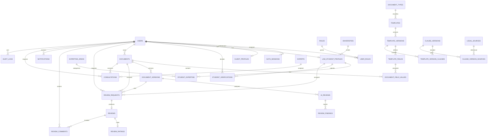

# Entity Relationship Diagram

`USER_ROLES`, `STUDENT_EXPERTISE`, `TEMPLATE_VERSION_CLAUSES`, and `CLAUSE_VERSION_SOURCES` are junction tables. `REVIEWS` has a unique `review_request_id`, making the request-to-review relationship one-to-zero-or-one. `CLIENT_PROFILES` and `LAW_STUDENT_PROFILES` each have a unique user foreign key.
