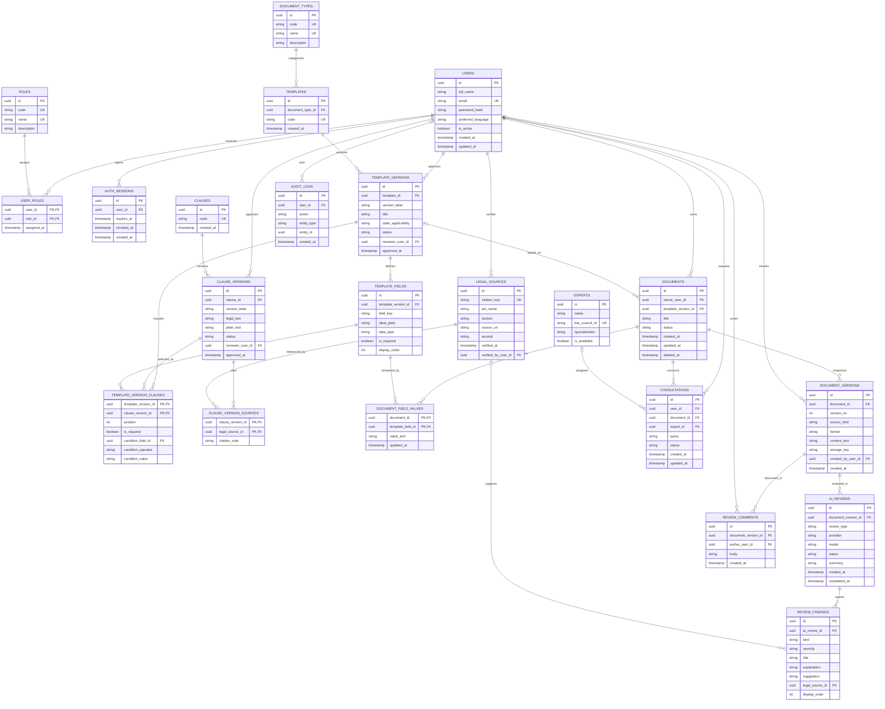

# SaralDocs Entity-Relationship Diagram

`DOCUMENTS.template_version_id` is nullable for uploaded documents not created
from a drafting template. `DOCUMENT_FIELD_VALUES` are valid only when that
document has the matching template version; the database trigger enforces this
cross-table rule. Review findings and comments point to immutable document
versions so history remains meaningful after a later generation.
